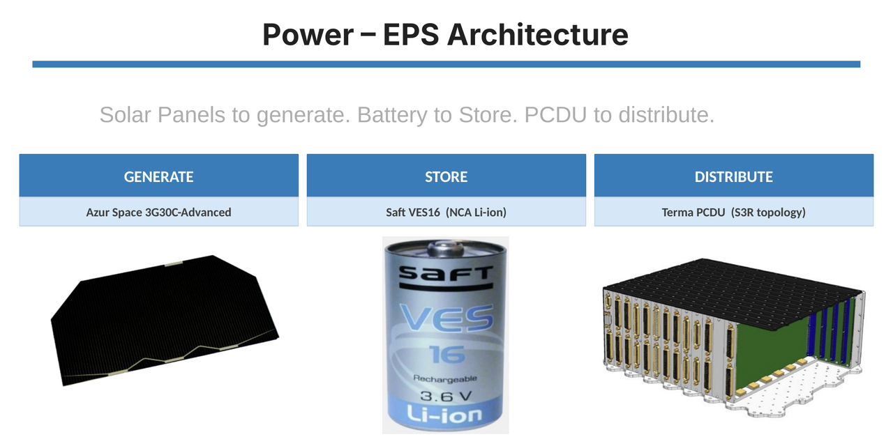

# ChLOE: Electrical Power System Sizing Model

Spreadsheet model for the Electrical Power System (EPS) of **ChLOE** (Chasers in Low Orbit around Earth), a preliminary spacecraft design developed by a team of ten students in the Spacecraft Design course (MAE 161C) at UCLA, spring 2026.

ChLOE is a mission concept of three autonomous chaser spacecraft, launched on a single Falcon 9, that image, dock with and refuel Starlink V2 Mini satellites in the 550 km, 53° shell. Each team member led one subsystem. I was the **Power Lead**, and this repository contains only my part: the Power Equipment List (PEL) and the EPS sizing.

## What the model does

| Sheet | Content |
|---|---|
| `PEL` | Every component's active and standby power draw, 10/20/30% contingency by design maturity (CBE to MEV), and nine operational modes (standby, nominal, imaging, refueling, thrusting, rendezvous, downlink, eclipse, safe) with a 30% system margin. |
| `Power` | Orbit and eclipse geometry (worst-case beta angle), solar array sizing with the SMAD power balance, battery sizing for depth of discharge and capacity fade, cycle-life check, PCDU losses and EPS mass. |

The two sheets are linked: change any component, margin or input and the mode budgets, array area, battery capacity and EPS mass update automatically. For example, lowering the Hall thruster input from 1,350 W to 1,000 W reduces the array from 14.6 m² to 12.6 m² and the EPS mass from 85.7 kg to 79.3 kg.

## Baseline results

| Output | Value |
|---|---|
| Orbit | 550 km circular, 95.5 min period, 35.6 min worst-case eclipse |
| Sizing modes | Thrusting (3,463 W) for the array, eclipse (1,236 W) for the battery |
| Solar array | 14.6 m², Azur Space 3G30C-Advanced GaAs triple-junction, 5,264 W BOL / 4,838 W EOL |
| Battery | Saft VES16 Li-ion, 1,267 Wh design capacity, 27,518 cycles over a 5-year design life (VES16 rated above 60,000) |
| Distribution | Terma PCDU, 100 V regulated bus (S3R) |
| EPS mass | 85.7 kg (array 57.5 kg, battery 8.2 kg, PCDU and harness 20 kg) |

## Files

- `ChLOE_EPS_Sizing_Model.xlsx`: the PEL and EPS sizing model.
- `ChLOE_Report_Power_Sections.pdf`: sections 9 (Power Equipment List) and 10 (Electrical Power System) of the team's final technical report, with the original title page crediting the full team.
- `ChLOE_Power_slides.pdf`: the power section of the team's final presentation, with the title slide crediting the full team.

## Notes

- Component power values in the PEL come from the subsystem leads of the team. The survival heater power (511.1 W, eclipse only) came from the Thermal subsystem; in the team workbook it was linked live to the Thermal sheet, and here it is a fixed input (blue cell with a comment).
- PCDU losses feed back into the power balance, so the workbook uses iterative calculation. It is enabled in the file; if your spreadsheet software warns about a circular reference, enable iterative calculation in its settings.

## Acknowledgements

Thanks to my nine teammates for their work on the other subsystems, and especially to Professor Dan Goebel for his guidance throughout the project.
